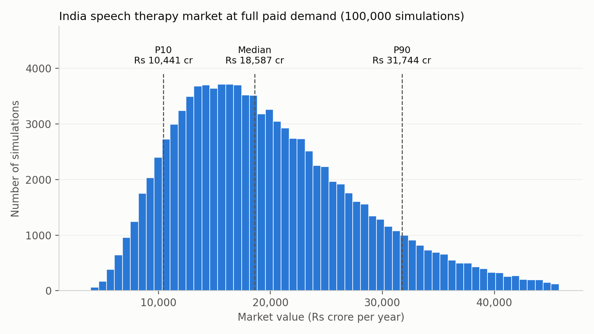
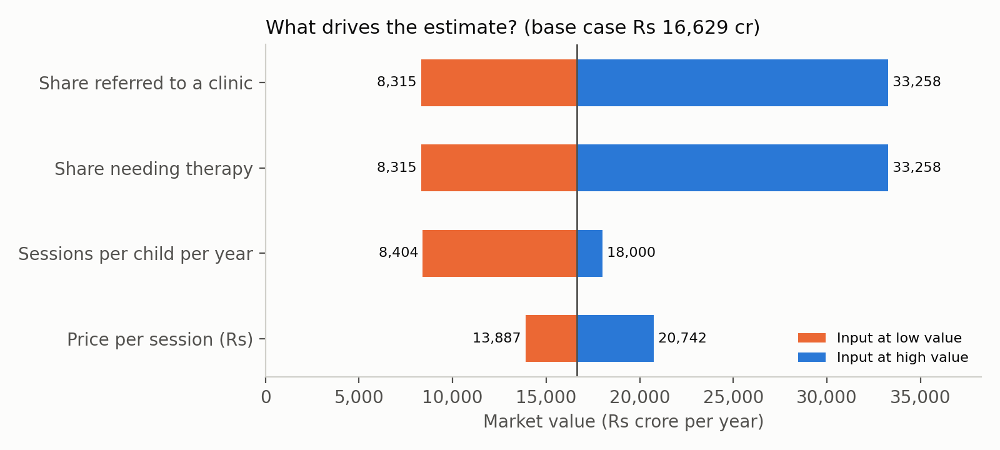

# India's Speech Therapy Gap

**How big is India's speech therapy market, and can its therapists meet the demand?**

## Key findings

- **~₹16,600 crore** a year in paid demand for children's speech therapy (base case)
- India's ~5,500 practising speech therapists can serve only **~5%** of it
- **~1 lakh more therapists** would be needed, while only ~2,500 graduate each year

**Recommendation:** help each therapist serve more children through group sessions, parent-led home practice, teletherapy and reminder tools.

## Method

1. **Market sizing (Excel):** a funnel from 35 crore children → those needing therapy → referred → starting therapy → sessions → market value. Key inputs come from primary research with a practising speech therapy clinic.
2. **Monte Carlo simulation (Python):** 100,000 runs with random values for each uncertain input. 80% of outcomes fall between **₹10,400 and ₹31,700 crore**.
3. **Sensitivity analysis:** the share of children diagnosed and referred matters far more than price.




## Files

| File | Description |
|---|---|
| `Speech_Therapy_Market_Model.xlsx` | Excel model with sources, low/base/high scenarios and a sensitivity grid |
| `main.py` | Monte Carlo simulation and charts |
| `India_Speech_Therapy_Market.pptx` | 8-slide deck with findings and recommendation |

To run the simulation:

```bash
pip install numpy matplotlib
python main.py
```

All figures are estimates. Full sources and assumptions are listed in the Excel Inputs sheet and the deck's appendix.
